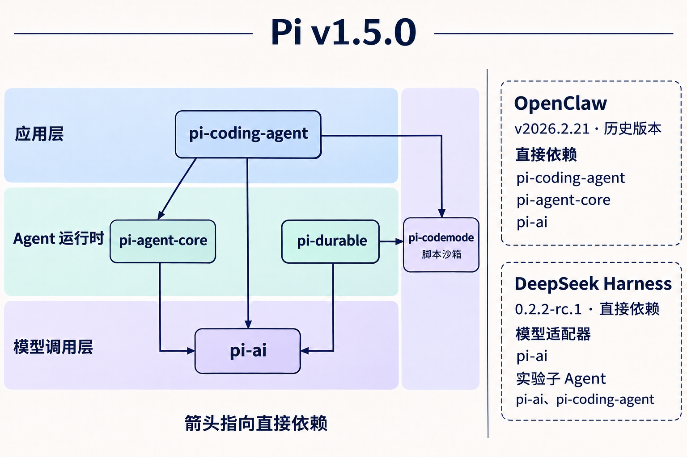

# Pi 的五个包：从模型调用到 Agent 运行时

在终端输入 `pi`，启动的是 `pi-coding-agent`。它用 `pi-agent-core` 跑模型与工具之间的循环，用 `pi-ai` 访问模型供应商。同仓库还有一套能在进程重启后恢复任务的运行时 `pi-durable`，也通过 `pi-ai` 调用模型。终端产品和 Durable 都可以用 `pi-codemode` 跑模型生成的工具脚本。下面以 2026 年 11 月 2 日发布的 **Pi v1.5.0** 为准，说明这五个包各自解决什么问题。 [Pi v1.5.0](https://github.com/earendil-works/pi/releases/tag/v1.5.0)

## pi-ai 统一模型调用

`pi-ai` 把不同供应商的模型请求封装为一套 TypeScript 接口。应用通过 `createModels()` 创建模型集合，注册 provider，再用 `models.streamSimple()` 或 `models.completeSimple()` 获取流式事件或完整响应。它处理模型目录、认证、消息与工具定义的转换，以及 token 用量和成本数据。不同供应商的能力仍有差异，应用可以在统一接口下选择实际支持的模型。 [模型接入与快速开始](https://github.com/earendil-works/pi/blob/v1.5.0/packages/ai/README.md#quick-start)

假设模型决定调用 `read`。这一层负责把工具定义传给供应商，解析流式返回的工具名和参数，并提供参数校验。真正读文件的是宿主提供的工具函数。读完以后要不要继续问模型，也由调用方决定。只需要发起模型请求的程序可以直接用 `pi-ai`，自己掌握调用时机。 [工具调用接口](https://github.com/earendil-works/pi/blob/v1.5.0/packages/ai/README.md#tools)

## pi-agent-core 执行 Agent 循环

`pi-agent-core` 在模型调用之上提供有状态的 `Agent`。应用传入模型、系统提示词、工具和模型流式调用函数，再调用 `agent.prompt()`。模型如果请求工具，Agent 就校验参数、执行工具、把结果加入上下文，供下一轮模型请求使用。应用可以订阅消息和工具执行事件来更新界面，也可以在运行中提交引导消息或后续消息。 [Agent Core 文档](https://github.com/earendil-works/pi/blob/v1.5.0/packages/agent/README.md)

这一循环的状态主要由进程内的 `Agent` 管理。宿主可以通过 `streamFn` 接入 `pi-ai`，也可以在事件处理和钩子里实现自己的会话存储与上下文转换。 [Agent Core 快速开始](https://github.com/earendil-works/pi/blob/v1.5.0/packages/agent/README.md#quick-start) · [Agent Core 配置](https://github.com/earendil-works/pi/blob/v1.5.0/packages/agent/README.md#agent-options)

## pi-coding-agent 提供终端编程助手

`pi-coding-agent` 提供 `pi` 命令和 TypeScript SDK。它把 Agent 循环与终端界面、读写文件和执行命令的工具、会话管理、扩展、技能及项目配置组装起来。除了在终端交互，还可以用 print 或 JSON 模式做脚本自动化，用 RPC 从另一个进程控制 Pi，或用 SDK 把编程会话嵌进自己的程序。 [Pi 使用方式](https://github.com/earendil-works/pi/blob/v1.5.0/README.md) · [CLI SDK](https://github.com/earendil-works/pi/blob/v1.5.0/packages/coding-agent/docs/sdk.md)

这里的会话管理包括从已保存的历史继续对话。比如 `pi --continue` 会打开最近的会话，而该会话里的消息会成为新 `Agent` 的初始上下文。CLI 还内置了 `codemode` 工具，常规配置下可用 `pi --tools +codemode` 为本次运行开启。工具的脚本执行由 `pi-codemode` 提供，CLI 扩展负责把会话里的工具开放给脚本。 [会话与工具选项](https://github.com/earendil-works/pi/blob/v1.5.0/packages/coding-agent/docs/cli.md) · [CLI 的 Code Mode 扩展](https://github.com/earendil-works/pi/blob/v1.5.0/packages/coding-agent/src/extensions/codemode/index.ts)

## pi-durable 保存并恢复执行进度

`pi-durable` 提供自己的 `Harness`，把对话、模型生成和工具调用纳入同一个任务调度系统。对话消息是不可变的条目，任务以状态机保存检查点，应用还可以把自己的 JSON 状态放进文档。一次原子提交可以同时追加条目、修改文档、推进任务状态。模型请求仍交给 `pi-ai`，文档状态则使用 Chord。 [Durable 概念](https://github.com/earendil-works/pi/blob/v1.5.0/packages/durable/README.md#concepts)

例如，Agent 已经保存了读取文件的结果，正等模型决定下一步，这时进程崩溃了。使用 SQLite 或 JSONL 存储时，宿主重新打开同一份存储并调用 `resume()`，调度器就能从已提交的状态接着跑。被打断的模型请求按重试策略处理。界面上的流式文本和工具进度可以先显示再落盘，崩溃时可能丢失最近一小段输出。 [重启恢复](https://github.com/earendil-works/pi/blob/v1.5.0/packages/durable/README.md#persist-and-resume) · [会话进度与落盘](https://github.com/earendil-works/pi/blob/v1.5.0/packages/durable/README.md#watching-a-conversation)

如果进程是在工具执行中崩溃的，只有声明了 `replay: "safe"` 的调用才会自动重跑，其他调用会给模型返回中断结果。若工具已经对外执行了操作，比如创建工单，重跑时的去重需要由工具或外部服务处理。 [工具重放规则](https://github.com/earendil-works/pi/blob/v1.5.0/packages/durable/README.md#tools)

Pi 1.0 从 `pi-agent-core` 移除了早期实验性的 `AgentHarness` 和持久会话接口，并将这类应用指向单独发布的 `pi-durable`。v1.5.0 的 CLI 仍由 `pi-agent-core` 驱动。Durable 的 API 标为实验性。 [Agent Core 1.0 变更](https://github.com/earendil-works/pi/blob/v1.5.0/packages/agent/CHANGELOG.md#100---2026-10-01) · [Pi Durable 发布说明](https://earendil.com/posts/pi-durable/#why-pi-durable)

## pi-codemode 在沙箱里组合工具

`pi-codemode` 用 QuickJS（WebAssembly）执行 JavaScript。脚本通过 `tools.<name>(args)` 调用宿主开放的工具。例如，模型可以写一段脚本并行读取十个文件，在脚本里筛出匹配项，只把文件名和相关行作为结果返回。中间的大段输出可以留在脚本里。脚本可访问的文件、网络或服务取决于宿主开放的工具与函数。这个沙箱库也可以独立嵌入应用。 [Code Mode 沙箱](https://github.com/earendil-works/pi/blob/v1.5.0/packages/codemode/README.md)

Durable 应用可以用 `@earendil-works/pi-durable/codemode` 导出的 `createCodemodeExtension()` 创建扩展并注册。扩展在把工具结果交给脚本前先写入日志。重启后，脚本从头运行，按原顺序拿回已记录的结果，继续推进到中断处。已经记录结果的调用无需再执行，仍在运行时被打断的调用按该工具自己的重放策略处理。 [Durable 的 Code Mode 集成](https://github.com/earendil-works/pi/blob/v1.5.0/packages/durable/README.md#code-mode)

## Pi 的分层与直接依赖

从上往下是应用、Agent 运行时和模型调用三层。外部应用也可以把中间层的 `pi-agent-core` 或 `pi-durable` 嵌进自己的产品。侧边的 `pi-codemode` 提供脚本沙箱，CLI 和 Durable 都可以调用它。实线箭头指向 Pi v1.5.0 的直接依赖，虚线框列出外部项目在所标版本中直接引用的 Pi 包。

清单里还有图外的依赖，例如 CLI 的 `pi-tui` 和 `pi-mcp`、Durable 的 `chord`，以及两个运行时都用到的 `pi-schema`。 [pi-ai](https://github.com/earendil-works/pi/blob/v1.5.0/packages/ai/package.json#L76) · [pi-agent-core](https://github.com/earendil-works/pi/blob/v1.5.0/packages/agent/package.json#L24) · [pi-coding-agent](https://github.com/earendil-works/pi/blob/v1.5.0/packages/coding-agent/package.json#L42) · [pi-durable](https://github.com/earendil-works/pi/blob/v1.5.0/packages/durable/package.json#L159) · [pi-codemode](https://github.com/earendil-works/pi/blob/v1.5.0/packages/codemode/package.json#L68)

- **OpenClaw v2026.2.21** 直接依赖 `pi-coding-agent`、`pi-agent-core` 和 `pi-ai`，三者当时都在 `@mariozechner/` 作用域下，版本是 `0.54.0`。到了 v2026.11.1，OpenClaw 已使用自己的 Agent 运行时，仍用图外的 `@earendil-works/pi-tui` 做终端界面。 [旧版包清单](https://github.com/openclaw/openclaw/blob/v2026.2.21/package.json#L151) · [v2026.11.1 运行时架构](https://github.com/openclaw/openclaw/blob/v2026.11.1/docs/agent-runtime-architecture.md#boundaries)
- **DeepSeek Harness v0.2.2-rc.1** 的多供应商模型适配器直接依赖 `pi-ai`。另一个实验性子 Agent 插件 OAR 直接依赖 `pi-ai` 和 `pi-coding-agent`，支持把 Pi 配置为委派任务的运行时。这两处清单都使用 `@earendil-works/` 作用域和 `^1.3.0` 版本范围。 [模型适配器清单](https://github.com/deepseek-ai/deepseek-harness/blob/dsh-v0.2.2-rc.1/packages/llm/llm-pi-ai/package.json#L41-L46) · [OAR 插件清单](https://github.com/deepseek-ai/deepseek-harness/blob/dsh-v0.2.2-rc.1/packages/experimental/subagent-oar/package.json#L40-L54) · [OAR 运行时配置](https://github.com/deepseek-ai/deepseek-harness/blob/dsh-v0.2.2-rc.1/packages/experimental/subagent-oar/README.md#configure-a-runtime-instance)

安装 CLI 或 Durable 时，包管理器会解析 `pi-codemode`。模型能否调用 `codemode`，则由 CLI 的工具配置或 Durable 的扩展注册决定。用 `pi-agent-core` 自己组装应用时，也可以把沙箱封装成一个 `AgentTool`。 [CLI 启用方式](https://github.com/earendil-works/pi/blob/v1.5.0/packages/coding-agent/docs/cli.md#enable-codemode) · [Durable 扩展](https://github.com/earendil-works/pi/blob/v1.5.0/packages/durable/README.md#code-mode) · [Agent Core 与 Code Mode 示例](https://github.com/earendil-works/pi/blob/v1.5.0/packages/codemode/README.md#using-with-pi-agent-core)

## 构建自己的 Agent 应用

如果做的是嵌进自己应用的 Agent，可以从实际要保存的状态入手。只需要运行模型与工具的循环，用 `pi-agent-core`。如果一个任务可能跨进程重启，且应用要恢复未完成的执行，可以单独选 `pi-durable` 作为 Agent 运行时，再配上持久存储。Durable 的快速开始示例还直接导入了 `pi-ai` 来配置模型和 `chord` 来提供执行上下文，因此应用通常会把这三个包都声明为直接依赖。使用内存存储可以先跑通交互，验证重启恢复时再改用 SQLite、JSONL 等持久存储。 [Agent Core 快速开始](https://github.com/earendil-works/pi/blob/v1.5.0/packages/agent/README.md#quick-start) · [Durable 安装](https://github.com/earendil-works/pi/blob/v1.5.0/packages/durable/README.md#installation) · [存储选项](https://github.com/earendil-works/pi/blob/v1.5.0/packages/durable/README.md#storage)

如果做的是给现有 Agent 新增一项能力，比如查询项目工单，工具的接入接口由宿主决定。在 Pi CLI 扩展里用 `pi.registerTool()`，在 Durable 应用里用 `defineTool()` 定义工具并注册扩展。两者都可以直接调用查询工单的函数。需要把查询、筛选和汇总交给模型生成的脚本时，再启用 Code Mode。 [Pi CLI 工具扩展](https://github.com/earendil-works/pi/blob/v1.5.0/packages/coding-agent/docs/extensions.md) · [Durable 工具定义](https://github.com/earendil-works/pi/blob/v1.5.0/packages/durable/README.md#tools)
